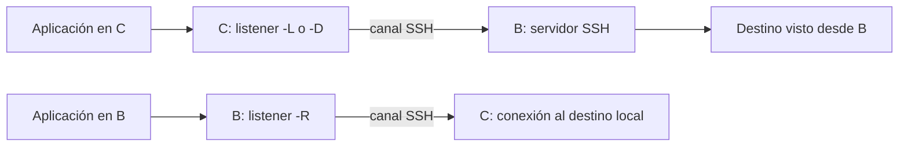

# SSH · Túneles TCP y acceso mediante bastiones

[Índice](README.md) · [Servidor Linux](06-servidor-linux.md) · [Referencia de túneles](12-referencia-tuneles.md)

El objetivo es comprobar la dirección de cada forwarding y acceder a un destino a través de un bastión conservando la autenticación de extremo a extremo. Un puerto que escucha no demuestra que el destino final sea accesible.

**Estado:** procedimiento documentado con OpenSSH Portable 10.6p1; todos los ensayos funcionales pendientes. Los ejemplos utilizan Linux/Bash, destinos propios y procesos en primer plano. No se han abierto puertos ni modificado servidores para producir esta documentación. Sockets Unix, túneles TUN/TAP, X11, cadenas avanzadas y Windows requieren sus bloques.

## 1. Identificar los equipos y el recorrido

| Equipo | Papel | Datos ficticios que hay que sustituir |
| --- | --- | --- |
| C | Cliente desde el que ejecutamos ssh. | Origen observado por B: 192.0.2.20. |
| B | Servidor SSH y bastión del laboratorio. | 192.0.2.10:2222, cuenta alumno. |
| T | Servidor SSH de destino accesible desde B. | 198.51.100.30:22, cuenta alumno. |

Los puertos SSH deben coincidir con la escucha real, que puede ser 22. No modificar sshd para hacer coincidir una cifra de la guía.

| Forma | Quién escucha | Quién abre la conexión final |
| --- | --- | --- |
| `-L 127.0.0.1:18000:127.0.0.1:8000` | C, puerto 18000. | B conecta a **su** 127.0.0.1:8000. |
| `-R 127.0.0.1:19000:127.0.0.1:9000` | B, puerto 19000. | C conecta a **su** 127.0.0.1:9000. |
| `-D 127.0.0.1:1080` | C, proxy SOCKS. | B conecta al destino solicitado por la aplicación. |
| `ProxyJump B` para llegar a T | No crea por sí solo un listener de servicio para otras aplicaciones en C. | B abre el transporte TCP a T; el cliente C autentica/verifica T a través de él. |



**Qué estás viendo.** El esquema separa la escucha de la salida final. `127.0.0.1` no significa siempre el cliente: se interpreta en el equipo que realiza ese tramo. SSH protege el tramo de su canal; no sustituye el cifrado o autenticación de otros protocolos en tramos adicionales.

## 2. Precondiciones y política del bastión

Disponer de consola/recuperación en B y T, claves públicas autorizadas y huellas verificables por canal independiente. Las privadas permanecen en C. Usaremos una identidad de C para B y otra para T, ya creadas/desplegadas mediante el [bloque de claves](04-claves-y-agente.md).

El perfil del bloque de servidor contiene `DisableForwarding yes`: **debe seguir bloqueando estos ejercicios hasta preparar una excepción deliberada de laboratorio**. No quitar esa protección globalmente para probar.

Como diseño de la excepción en B, para la cuenta y origen indicados:

```sshconfig
Match User alumno Address 192.0.2.20/32
    DisableForwarding no
    AllowTcpForwarding yes
    PermitOpen 127.0.0.1:8000 198.51.100.30:22
    PermitListen 127.0.0.1:19000
    GatewayPorts no
    AllowAgentForwarding no
```

**Qué estás viendo.** Es un fragmento para el **candidato**, no una orden para añadir a ciegas al archivo activo. `PermitOpen` limita destinos abiertos desde B para local/dynamic/stdio y ProxyJump; `PermitListen` limita la solicitud de escucha remota. El destino estático de `-R` lo abre C y no queda limitado por PermitOpen de B.

Aplicar el procedimiento de [copia, candidato, validación y restauración](06-servidor-linux.md). Reconciliar reglas anteriores: entre bloques Match coincidentes importa la primera asignación aplicable. El fragmento tampoco crea cuentas, claves o rutas ni anula restricciones de authorized_keys.

Con la ruta del binario de B ya identificada:

```sh
sudo "$ssh_server_bin" -t -f /ruta/real/al/candidato
sudo "$ssh_server_bin" -T -f /ruta/real/al/candidato -C user=alumno,addr=192.0.2.20,host=cliente.example,laddr=192.0.2.10,lport=2222
```

**Qué estás viendo.** Sustituir candidato y datos por los reales, especialmente origen tras NAT y puerto visto por sshd. Revisar `disableforwarding no`, `allowtcpforwarding yes`, listas permitidas, `gatewayports no` y `allowagentforwarding no`. Repetir para un usuario/origen fuera de la excepción y comprobar que mantiene su política previa.

`-T -C` no evalúa todas las restricciones de una pública concreta. Opciones como `restrict`, `no-port-forwarding`, `permitopen` o `permitlisten` pueden imponer límites adicionales. Un rechazo requiere revisar esa política, no borrar sus restricciones por rutina.

Validar/recargar solo con recuperación preparada. En T no se necesita habilitar forwarding para la sesión ordinaria de destino de este ejemplo. Si no se puede preparar la excepción, registrar las pruebas como pendientes.

## 3. Configuración cliente y confianza separada

En C, desde la carpeta privada de trabajo de los bloques anteriores, guardar `ssh-tuneles.conf` con datos reales:

```sshconfig
Host salto-lab
    HostName 192.0.2.10
    Port 2222
    User alumno
    IdentityFile ./id_ed25519_lab

Host destino-lab
    HostName 198.51.100.30
    Port 22
    User alumno
    IdentityFile ./id_ed25519_destino_lab
    ProxyJump salto-lab

Host salto-lab destino-lab
    UserKnownHostsFile ./known_hosts_tuneles_lab
    StrictHostKeyChecking ask
    IdentitiesOnly yes
    IdentityAgent none
    AddKeysToAgent no
    ForwardAgent no
    ExitOnForwardFailure yes
    ConnectTimeout 5
    ConnectionAttempts 1
    ControlMaster no
    ControlPath none
```

**Qué estás viendo.** B y T tienen identidad, puerto y configuración propios. La segunda privada debe existir en C y su pública estar autorizada en T; si falta, preparar ese requisito o dejar pendiente el salto. No copiar privadas al bastión. Las rutas relativas se resuelven desde el cwd de C; mantener esa carpeta también en las otras terminales cliente.

Primero inspeccionar configuración:

```sh
ssh -F ./ssh-tuneles.conf -G salto-lab
ssh -F ./ssh-tuneles.conf -G destino-lab
```

**Qué estás viendo.** Confirmar por separado destino, cuenta, identidad y `proxyjump`. `-G` no abre el camino ni demuestra que B pueda alcanzar T. El archivo propio permite configurar el proceso de salto; las opciones CLI de identidad/usuario del destino no se trasladan automáticamente al bastión.

Desde consola obtener la fingerprint de las claves de host realmente utilizadas en B y T, como en [primera conexión](02-conexion-basica.md#3-obtener-la-huella-esperada-desde-el-servidor). Después, conectar verificando cada aviso con su referencia independiente:

```sh
ssh -F ./ssh-tuneles.conf salto-lab hostname
ssh -F ./ssh-tuneles.conf destino-lab hostname
```

**Qué estás viendo.** La segunda conexión usa ProxyJump: primero se autentica el salto y después T. Comparar la huella del equipo que aparece en cada aviso; dos nombres o dos hostnames impresos no sustituyen esas comprobaciones.

Una vez registrada la confianza correcta, cambiar `StrictHostKeyChecking ask` a `yes` en este archivo y repetir las conexiones. Si la huella cambia, investigar; no pasar a `no`. Las comprobaciones principales siguientes presuponen confianza preparada.

## 4. Preparar respuestas distinguibles

Se necesitan Python 3 con `http.server --directory` y curl con SOCKS, ya disponibles en los equipos que se indiquen. Registrar sus versiones. Son herramientas auxiliares para datos de laboratorio, no dependencias nuevas de Biblioteca.

En una consola de **B**, como la cuenta de laboratorio y desde su home, crear una carpeta nueva:

```bash
mkdir -m 700 ./fwd-lab-20261022 &&
mkdir ./fwd-lab-20261022/http-b &&
printf 'respuesta-bastion\n' > ./fwd-lab-20261022/http-b/prueba.txt
```

**Qué estás viendo.** Si ya existe, elegir otro nombre y corregir las rutas; no reutilizar una carpeta con datos desconocidos. `&&` detiene la cadena en error. Servir solo este subdirectorio sin secretos/enlaces, nunca el home o la carpeta con privadas.

En una terminal de B, mantener en primer plano:

```sh
python3 -m http.server 8000 --bind 127.0.0.1 --directory ./fwd-lab-20261022/http-b
```

**Qué estás viendo.** Servicio HTTP mínimo de prueba, limitado a loopback y directorio dedicado. No es un servidor para producción. No ejecutarlo sin `--bind`: el default de la herramienta puede escuchar en todas las interfaces.

En **C**, crear otra raíz nueva en su carpeta de trabajo:

```bash
mkdir -m 700 ./fwd-lab-20261022 &&
mkdir ./fwd-lab-20261022/http-c &&
printf 'respuesta-cliente\n' > ./fwd-lab-20261022/http-c/prueba.txt
```

**Qué estás viendo.** Es otro filesystem aunque la carpeta tenga el mismo nombre. En otra terminal de C, mantener:

```sh
python3 -m http.server 9000 --bind 127.0.0.1 --directory ./fwd-lab-20261022/http-c
```

**Qué estás viendo.** La respuesta cliente permitirá demostrar el sentido de `-R`. Comprobar cada servicio desde su propio equipo con una petición local antes de utilizar SSH.

Las aplicaciones se mantienen en primer plano y se cierran con Ctrl+C en **su terminal identificada**. No terminar procesos por coincidencia de nombre ni detener servicios del sistema para hacer sitio.

## 5. Forwarding local -L

En una terminal de C:

```sh
ssh -v -N -a -F ./ssh-tuneles.conf -L 127.0.0.1:18000:127.0.0.1:8000 salto-lab
```

**Qué estás viendo.** C escucha en 127.0.0.1:18000; B abre cada conexión final a su 127.0.0.1:8000. `-N` mantiene transporte sin comando remoto. `-a` mantiene el agente sin reenviar; no impide que el cliente utilice un agente local en una configuración que lo permita.

En otra terminal de C:

```sh
ss -ltnp
curl --noproxy "*" --fail --show-error --silent --max-time 5 http://127.0.0.1:18000/prueba.txt
```

**Qué estás viendo.** Revisar dirección de escucha y proceso, no solo el número de puerto. ss puede ocultar detalles de procesos de otras cuentas si no se dispone de permisos. La respuesta debe ser `respuesta-bastion`. `--noproxy "*"` impide que una configuración de proxy ajena desvíe esta petición directa. Registrar el retorno de curl inmediatamente; es distinto del retorno de ssh cuando se cierre.

La escucha en loopback limita interfaces, no autentica a otros procesos/usuarios del mismo equipo. HTTP transporta aquí únicamente datos ficticios. Un túnel no sustituye TLS o la autorización de una aplicación real.

Cerrar ese ssh con Ctrl+C y comprobar que ya no aparece su listener en C antes de reutilizar la terminal para el siguiente caso.

## 6. Forwarding remoto -R

Con el servicio C:9000 todavía activo, ejecutar en C:

```sh
ssh -v -N -a -F ./ssh-tuneles.conf -R 127.0.0.1:19000:127.0.0.1:9000 salto-lab
```

**Qué estás viendo.** El listener se solicita en **B**. Cuando una aplicación de B lo usa, el cliente SSH en C conecta a **C:9000**. La solicitud puede ser denegada por política o falta de puerto; comprobar mensajes, no deducir éxito porque el proceso exista.

Desde consola de B:

```sh
ss -ltnp
curl --noproxy "*" --fail --show-error --silent --max-time 5 http://127.0.0.1:19000/prueba.txt
```

**Qué estás viendo.** Debe escuchar en loopback de B y devolver `respuesta-cliente`. El `GatewayPorts no` del contexto servidor forma parte de la precondición: `yes` puede forzar una escucha wildcard y cambiar la exposición aunque el cliente solicite una dirección concreta.

`PermitListen 127.0.0.1:19000` coincide con la solicitud explícita. La solicitud implícita `localhost` no se trata necesariamente como la cadena `127.0.0.1`; no cambiar entre ambas sin revisar reglas. Mantener el puerto visible solo donde se pretende.

Cerrar la sesión de forwarding y comprobar en B la retirada de su listener. Una conexión ya establecida o TIME_WAIT no es una escucha activa: consultar el estado adecuado.

## 7. Proxy SOCKS local -D

En C:

```sh
ssh -v -N -a -F ./ssh-tuneles.conf -D 127.0.0.1:1080 salto-lab
```

**Qué estás viendo.** C ofrece SOCKS4/5 en ese listener; las conexiones finales salen desde B y deben satisfacer sus restricciones. No reconfigura automáticamente el navegador ni todo el tráfico del sistema.

Desde otra terminal de C:

```sh
curl --proxy socks5h://127.0.0.1:1080 --noproxy "" --fail --show-error --silent --max-time 5 http://127.0.0.1:8000/prueba.txt
```

**Qué estás viendo.** Debe devolver `respuesta-bastion`, porque el destino 127.0.0.1:8000 es visto desde B. `--noproxy ""` evita que NO_PROXY/no_proxy omita el proxy en esta prueba. `socks5h` pide resolver nombres por el proxy; este ejemplo numérico comprueba dirección de salida, **no una resolución DNS real**.

Un ensayo DNS adicional necesita un nombre de laboratorio resoluble en el extremo previsto, y comparar `socks5` con `socks5h` conforme al cliente. No atribuir al túnel una garantía de ausencia de fugas DNS de cualquier aplicación. Mantener el proxy en loopback y cerrarlo al terminar.

## 8. Bastión y ProxyJump

El archivo de C ya contiene `ProxyJump salto-lab` para T. Inspeccionar y ejecutar:

```sh
ssh -v -F ./ssh-tuneles.conf destino-lab hostname
```

**Qué estás viendo.** B transporta TCP hacia 198.51.100.30:22; C negocia SSH con T y verifica su host key. La privada de destino sigue en C. B puede observar metadatos del tránsito, pero no necesita que se le preste el agente para esta autenticación.

La configuración de B permite exactamente ese destino en `PermitOpen` y local forwarding. Por sí solo, poder hacer login en B no demuestra que se permita abrir ese canal. Si se deniega, localizar salto, política y destino; no habilitar `-A` para intentar resolver un fallo de red.

Como forma CLI alternativa, un único `-J salto-lab` selecciona ese salto. Para varios saltos se utiliza una lista separada por comas, no repeticiones de -J. Cada salto requiere su configuración/identidad/confianza y conectividad al siguiente; los casos multihop quedan pendientes del desarrollo avanzado.

Si se quiere inspeccionar solo el flujo stdio empleado por una técnica de proxy, se puede usar `-W host:puerto` conforme a la ficha. No es una shell remota ni crea por sí mismo un proxy SOCKS para aplicaciones.

## 9. Errores que deben probarse

| Caso | Resultado que hay que distinguir |
| --- | --- |
| Listener local ocupado | Con ExitOnForwardFailure yes, fallo de establecimiento y terminación del intento. |
| Listener remoto rechazado/ocupado | Rechazo de la solicitud; revisar PermitListen/GatewayPorts y conflicto de puerto. |
| Destino final no disponible | El listener puede establecerse y SSH seguir abierto; falla la conexión de aplicación. |
| PermitOpen deniega un destino | Puede fallar al abrir el canal, después de que el listener local exista. |
| DisableForwarding yes efectivo | La política bloquea forwarding aunque otras directivas parezcan permisivas. |
| Clave con restricción adicional | El contexto -T correcto no elimina esa restricción. |
| ProxyJump llega a B pero no a T | Separar canal TCP, negociación de T, host key y autenticación de destino. |
| Agente local utilizable y ForwardAgent no | Puede servir a C sin crear una delegación en B; no son la misma operación. |

Para demostrar que `ExitOnForwardFailure` no prueba el servicio final, mantener un `-L` activo hacia B:8000 y detener **solo el HTTP de prueba de B** mediante su Ctrl+C. Repetir curl: el canal debe fallar, pero el listener/SSH pueden continuar. Restaurar el HTTP propio y comprobar recuperación. No detener sshd, la red ni un servicio ajeno.

Para un conflicto de listener, intentar otro `-L` sobre C:9000 mientras el HTTP de C lo ocupa, o un segundo `-R` sobre B:19000 mientras el primero está activo y permitido. Identificar ambos procesos; el intento fallido no autoriza a terminar el que ya utilizaba el puerto.

Estos son casos pendientes, no resultados observados. Registrar stdout/stderr, retorno de cada proceso y fase; un mensaje de canal no es necesariamente un cierre del transporte completo.

## 10. Cierre y evidencia

1. Cerrar los procesos ssh de forwarding del ejercicio en sus terminales, sin reutilización por ControlMaster.
2. Comprobar que los listeners C:18000/C:1080 y B:19000 desaparecen y que no se dejó una escucha wildcard inesperada.
3. Cerrar los HTTP de prueba de C:9000 y B:8000 y revisar sus puertos.
4. Restaurar la excepción de política de B desde su copia identificada, validar y recargar por el procedimiento del servidor.
5. Comprobar nueva conexión de recuperación y política anterior; retirar solo los archivos creados para este ejercicio cuando ya no se necesiten.

No eliminar claves, known_hosts ni carpetas ajenas para cerrar un túnel. Eliminar un archivo de configuración no termina un proceso ssh ya iniciado; tampoco retirar una excepción garantiza cerrar conexiones existentes sin comprobarlo.

- [ ] Topología, versiones y puertos reales registrados.
- [ ] Huellas de B/T verificadas de forma independiente y privadas conservadas en C.
- [ ] Excepción limitada validada; otros usuarios/orígenes mantienen su política.
- [ ] -L devuelve respuesta de B y escucha solo en C loopback.
- [ ] -R devuelve respuesta de C y escucha solo en B loopback.
- [ ] SOCKS usa el recorrido esperado; DNS queda registrado como ensayo independiente.
- [ ] ProxyJump autentica T sin agent forwarding.
- [ ] Fallo de listener separado de fallo de destino/canal y restricciones por clave.
- [ ] Procesos/listeners de laboratorio cerrados sin afectar servicios ajenos.
- [ ] Política restaurada y acceso de recuperación probado mediante nueva conexión.

## Fuentes y cobertura

- [ssh(1)](https://github.com/openssh/openssh-portable/blob/a8c72b842423f0774f542d3c2197247c3dd28d74/ssh.1), [ssh_config(5)](https://github.com/openssh/openssh-portable/blob/a8c72b842423f0774f542d3c2197247c3dd28d74/ssh_config.5) y [sshd_config(5)](https://github.com/openssh/openssh-portable/blob/a8c72b842423f0774f542d3c2197247c3dd28d74/sshd_config.5): Portable 10.6p1.
- [Referencia de túneles](12-referencia-tuneles.md): opciones, directivas y límites del alcance.
- [Python: http.server](https://docs.python.org/3/library/http.server.html): servidor mínimo, bind y directorio; registrar versión instalada.
- [curl: manual oficial](https://curl.se/docs/manpage.html): proxy, SOCKS, noproxy y comprobación HTTP; su catálogo queda fuera del bloque.

Consulta: 22 de octubre de 2026. Desarrollo parcial de SSH-T07, SSH-C002/C003/C004/C010/C024 y SSH-P05/P06. Todas las pruebas siguen pendientes; no se declara completo el catálogo de forwarding ni la compatibilidad por plataforma.
