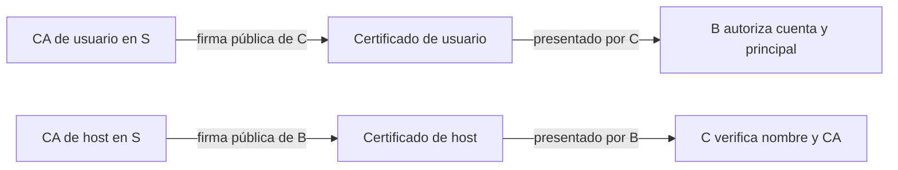

# SSH · Certificados, CA y revocación

[Índice](README.md) · [Referencia](14-referencia-certificados.md) · [Comprobaciones locales](15-verificacion-certificados-windows.md)

Un certificado OpenSSH vincula una pública con principals, un identificador, un serial y un intervalo, mediante la firma de una Certification Authority (CA) — autoridad de certificación. La privada correspondiente sigue siendo necesaria para autenticarse. Este formato es distinto de X.509/TLS y no convierte por sí solo un principal en una cuenta del sistema.

**Referencia documental:** OpenSSH Portable 10.6p1, consulta del 23 de octubre de 2026. La emisión/inspección y las operaciones KRL tienen [evidencia local limitada a Windows 9.5p2](15-verificacion-certificados-windows.md). Las conexiones, el despliegue y la restauración en servidores Linux siguen **pendientes de laboratorio**.

## 1. Separar identidad, confianza y autorización

| Equipo | Responsabilidad | Material que conserva |
| --- | --- | --- |
| S · firmante | Emitir certificados y preparar revocaciones. | Privadas protegidas de dos CA de laboratorio, una de usuario y otra de host. |
| C · cliente | Autenticarse como la cuenta alumno. | Su privada id_usuario_lab, certificados públicos y pública de CA de host. |
| B · servidor Linux | Presentar identidad de host y autorizar a alumno. | Su privada de host existente, certificado de host, pública de CA de usuario, principals y KRL. |

S puede ser un entorno aislado de administración; no copiar sus privadas a C/B para facilitar las pruebas. Separar las CA limita su función, aunque ambas utilicen Ed25519. Los certificados y públicas no son secretos, pero su **integridad y procedencia** determinan la confianza.



**Qué estás viendo.** Son dos verificaciones independientes. B confía en quien firma usuarios; C confía en quien firma servidores. La KRL solo actúa donde se distribuye y se consulta.

## 2. Preparación y recuperación

Necesitamos consola de B, acceso existente verificado, una cuenta de laboratorio y el [procedimiento de candidato/recarga/restauración](06-servidor-linux.md). Mantener esa vía de recuperación durante todos los cambios.

Los datos ficticios son B `192.0.2.10:2222`, origen de C observado en B `192.0.2.20`, cuenta `alumno` y nombre certificado `servidor.lab.example`. Sustituirlos por los reales; no cambiar puertos o DNS para adaptarse a la guía. Sincronizar/revisar relojes de S, C y B antes de interpretar un rechazo temporal.

Trabajar en carpetas nuevas y privadas, fuera de repositorios/sincronización. Registrar SO/build y versión de cada binario. En Linux/Bash, antes de crear las claves:

```sh
umask 077
mkdir ./ssh-ca-lab-20261023
cd ./ssh-ca-lab-20261023
ssh -V
```

**Qué estás viendo.** mkdir debe crear un directorio nuevo; si ya existe, elegir otro nombre y detener la secuencia. umask afecta a nuevas creaciones del shell, no corrige permisos/ACL de archivos existentes. Este bloque es para Linux/Bash; no trasladar umask a PowerShell.

En B identificar la HostKey Ed25519 realmente configurada y su pública, sin generar/sustituir claves de host. Si se utiliza otro algoritmo, adaptar todo el ejemplo tras revisar disponibilidad y política; no habilitar algoritmos rechazados para continuar.

## 3. Crear CA e identidad de usuario

En S:

```sh
ssh-keygen -t ed25519 -f ./ca_usuario_lab -C ca-usuario-lab
ssh-keygen -t ed25519 -f ./ca_host_lab -C ca-host-lab
```

**Qué estás viendo.** Cada orden solicita frase de paso para proteger su privada; elegirla interactivamente, sin añadirla a la línea de comandos o a la documentación. Se crean la privada indicada y su .pub. No sobrescribir un nombre existente. Las públicas de ambas CA tienen que verificarse por un canal independiente antes de desplegarlas como confianza.

En C:

```sh
ssh-keygen -t ed25519 -f ./id_usuario_lab -C usuario-cert-lab
ssh-keygen -l -E sha256 -f ./id_usuario_lab.pub
```

**Qué estás viendo.** La privada de usuario permanece en C. La huella identifica la pública que se solicita certificar; comparar la recibida en S. Estas operaciones se desarrollan en el [bloque de claves](04-claves-y-agente.md).

Enviar a S **solo** la pública de C como `usuario_v1.pub` y la pública de host de B como `host_lab.pub`, usando consola o transferencias con confianza ya preparada. Verificar procedencia/huellas; una CA no debe firmar una pública solo por el nombre de su archivo.

## 4. Emitir e inspeccionar certificados

En S, con nombres de salida libres:

```sh
ssh-keygen -s ./ca_usuario_lab -I usuario-lab-1001 -n operador-lab -V -5m:+1h -z 1001 -O clear ./usuario_v1.pub
ssh-keygen -L -f ./usuario_v1-cert.pub
```

**Qué estás viendo.** -s firma con la privada de CA; -I es el key ID para inventario/log, -n contiene el principal autorizado, -z fija un serial de esa CA y -V limita el tiempo. El inicio cinco minutos anterior tolera un desfase pequeño, no sustituye sincronizar relojes.

El archivo resultante se llama usuario_v1-cert.pub. Revisar Type (user), Signing CA, Key ID, Serial, Valid, Principals, Critical Options y Extensions. Comparar la CA y la pública de origen con sus referencias. `-L` muestra contenido: **también puede mostrar un certificado ya expirado y no demuestra aceptación ni verificación de su firma por un servidor**.

`-O clear` elimina permisos opcionales predeterminados como PTY y forwarding. No elimina un force-command/source-address añadido ni impide por sí solo ejecutar comandos o una shell sin PTY. La política de B sigue aplicándose.

Para B:

```sh
ssh-keygen -s ./ca_host_lab -I host-lab-2001 -h -n servidor.lab.example -V -5m:+1d -z 2001 ./host_lab.pub
ssh-keygen -L -f ./host_lab-cert.pub
```

**Qué estás viendo.** -h cambia el tipo a host. El principal es el nombre que C debe verificar, no el usuario alumno. La pública certificada debe corresponder exactamente a la HostKey privada que B utiliza. Las restricciones -O de usuario no se trasladan al certificado de host.

Anotar CA, pública firmada, tipo, key ID, serial, principals y validez en el registro de emisión, sin privadas ni frases. No reutilizar seriales de la misma CA; -z no mantiene un contador entre ejecuciones.

## 5. Preparar listas iniciales de revocación

En S, generar KRL válidas inicialmente vacías:

```sh
: > ./sin-revocaciones.txt
ssh-keygen -k -f ./usuarios-v1.krl -z 1 ./sin-revocaciones.txt
ssh-keygen -k -f ./hosts-v1.krl -z 1 ./sin-revocaciones.txt
ssh-keygen -Q -f ./usuarios-v1.krl ./usuario_v1-cert.pub
ssh-keygen -Q -f ./hosts-v1.krl ./host_lab-cert.pub
```

**Qué estás viendo.** Las rutas pertenecen a la carpeta nueva. -k produce una KRL binaria desde una especificación vacía; un archivo de texto vacío **no es por sí mismo una KRL**. -z es aquí la versión administrativa de la KRL, distinta del serial de un certificado.

Cada consulta debe devolver 0 mientras no haya revocaciones. En Bash registrar `$?` inmediatamente después de cada orden; en PowerShell sería `$LASTEXITCODE`. No consultar el retorno tras ejecutar otra orden. Un retorno no cero puede significar revocación **o error de lectura/formato**: interpretar stderr, no etiquetar todo fallo como REVOKED.

Distribuir a B la pública de CA de usuario, el certificado de host y usuarios-v1.krl. Distribuir a C el certificado de usuario, la pública de CA de host y hosts-v1.krl. Comprobar contenido/huellas y que las KRL se pueden consultar en destino. Las privadas de CA no viajan.

## 6. Preparar el candidato de B

Los destinos siguientes son exclusivos de laboratorio. Si algún archivo ya existe, detenerse y reconciliarlo con su propietario y copia identificada. No reemplazar confianza o revocaciones ajenas.

En el directorio de recepción de B, preparar y revisar:

```sh
printf 'operador-lab\n' > ./alumno.principals
sudo install -d -m 0755 /etc/ssh/ca-lab /etc/ssh/principals-lab /etc/ssh/revocaciones-lab
sudo install -m 0644 ./ca_usuario_lab.pub /etc/ssh/ca-lab/usuario.pub
sudo install -m 0644 ./alumno.principals /etc/ssh/principals-lab/alumno
sudo install -m 0644 ./usuarios-v1.krl /etc/ssh/revocaciones-lab/usuarios.krl
sudo install -m 0644 ./host_lab-cert.pub /etc/ssh/ssh_host_ed25519_key-cert.pub
```

**Qué estás viendo.** Se instalan públicas, certificado y política legibles por sshd y administrados por root. La cuenta alumno no debe poder editar la CA o su lista de principals. Revisar propietarios, permisos y controles de acceso adicionales, incluidos contextos SELinux donde proceda. Ninguna orden modifica la privada de host.

Integrar en el **candidato** del bloque de servidor, manteniendo la HostKey real ya identificada:

```sshconfig
# Global, antes de cualquier Match:
HostCertificate /etc/ssh/ssh_host_ed25519_key-cert.pub

Match User alumno Address 192.0.2.20/32
    TrustedUserCAKeys /etc/ssh/ca-lab/usuario.pub
    AuthorizedPrincipalsFile /etc/ssh/principals-lab/%u
    RevokedKeys /etc/ssh/revocaciones-lab/usuarios.krl
```

**Qué estás viendo.** HostCertificate solo es global. La autorización de CA de usuario queda limitada al contexto alumno/origen de laboratorio. El principal operador-lab puede autorizar a alumno porque su archivo lo incluye; el certificado no crea esa cuenta. No relajar otras reglas, DisableForwarding o MFA para lograr aceptación.

Aplicar la validación de sintaxis y contexto del bloque 6:

```sh
sudo "$ssh_server_bin" -t -f /ruta/real/al/candidato
sudo "$ssh_server_bin" -T -f /ruta/real/al/candidato -C user=alumno,addr=192.0.2.20,host=cliente.example,laddr=192.0.2.10,lport=2222
```

**Qué estás viendo.** ssh_server_bin es la ruta real ya identificada en la práctica de servidor. Sustituir candidato, direcciones y puerto. Confirmar HostCertificate, TrustedUserCAKeys, AuthorizedPrincipalsFile y RevokedKeys efectivos; repetir fuera de la excepción y comparar con la política anterior. -t/-T no sustituyen el ensayo de autenticación ni garantizan que toda restricción de certificado/archivo vaya a cumplirse.

Activar/recargar siguiendo el procedimiento recuperable de servidor y conservar consola/sesión previa. `RevokedKeys` inaccesible puede bloquear la autenticación por pública de todos los usuarios a los que aplique. Crear/verificar el archivo antes de activar la directiva.

## 7. Preparar confianza y selección de certificados en C

Guardar junto a la privada id_usuario_lab el certificado usuario_v1-cert.pub, la pública ca_host_lab.pub y hosts-v1.krl. Crear un known_hosts propio, limitado al nombre de laboratorio:

```sh
awk '{print "@cert-authority servidor.lab.example " $1 " " $2}' ./ca_host_lab.pub > ./known_hosts_ca_lab
```

**Qué estás viendo.** La entrada contiene el marcador @cert-authority, el nombre autorizado y los campos tipo/base64 de la pública de CA. No pegar la privada ni el certificado de B como si fueran la CA. Este awk presupone una única pública previamente validada, y escribe un archivo nuevo dedicado.

Crear ssh-ca-lab.conf con datos reales:

```sshconfig
Host destino-ca
    HostName 192.0.2.10
    Port 2222
    User alumno
    HostKeyAlias servidor.lab.example
    IdentityFile ./id_usuario_lab
    CertificateFile ./usuario_v1-cert.pub
    UserKnownHostsFile ./known_hosts_ca_lab
    GlobalKnownHostsFile none
    RevokedHostKeys ./hosts-v1.krl
    StrictHostKeyChecking yes
    HostKeyAlgorithms ssh-ed25519-cert-v01@openssh.com
    PubkeyAcceptedAlgorithms ssh-ed25519-cert-v01@openssh.com
    PreferredAuthentications publickey
    PasswordAuthentication no
    KbdInteractiveAuthentication no
    IdentitiesOnly yes
    IdentityAgent none
    ForwardAgent no
    ControlMaster no
    ControlPath none
    ConnectTimeout 5
    ConnectionAttempts 1
```

**Qué estás viendo.** El perfil de prueba exige certificado Ed25519 para host y usuario: así un acceso con clave ordinaria no enmascara el ensayo. Es una selección acotada para estas claves de laboratorio, no una recomendación general de sustituir la política de algoritmos del sistema. Si B exige otro factor, el ensayo no cumplirá esa política y debe adaptarse deliberadamente, conservando MFA.

HostKeyAlias define el nombre lógico que se consulta y se valida en el certificado; no cambia DNS ni prueba que una IP pertenezca a ese nombre. En este caso la entrada known_hosts utiliza exactamente servidor.lab.example, incluso con puerto de transporte distinto de 22. No reutilizar ese alias para servidores ajenos.

Las rutas relativas se resuelven desde el cwd de C. Inspeccionar y conectar desde esa carpeta:

```sh
ssh -F ./ssh-ca-lab.conf -G destino-ca
ssh -v -T -F ./ssh-ca-lab.conf destino-ca hostname
```

**Qué estás viendo.** -G permite revisar rutas, alias, algoritmos y autenticación solicitada. En la conexión buscar certificado de host, CA encontrada, nombre validado y oferta/aceptación del certificado de usuario; correlacionar con el log de B. hostname por sí solo no identifica el método que permitió entrar. El comando no solicita PTY, coherente con clear.

## 8. Revocar el certificado de usuario por serial

En S:

```sh
printf 'serial: 1001\n' > ./revocar-usuario.txt
cp ./usuarios-v1.krl ./usuarios-v2.krl
ssh-keygen -k -u -f ./usuarios-v2.krl -s ./ca_usuario_lab.pub -z 2 ./revocar-usuario.txt
ssh-keygen -Q -l -f ./usuarios-v2.krl
ssh-keygen -Q -f ./usuarios-v2.krl ./usuario_v1-cert.pub
```

**Qué estás viendo.** Se actualiza una **copia candidata**, conservando entradas anteriores. -s identifica aquí la CA **pública**, no firma la KRL. El serial 1001 solo se refiere a certificados de esa CA. La consulta del certificado revocado debe ser no cero con REVOKED; conservar el caso positivo de un certificado no revocado.

Transferir/verificar usuarios-v2.krl en B y consultar la copia candidata antes del despliegue. No ejecutar -k -u directamente contra el archivo que sshd está leyendo. Con el nombre .nueva libre y los archivos en el mismo filesystem:

```sh
sudo install -m 0644 ./usuarios-v2.krl /etc/ssh/revocaciones-lab/usuarios.krl.nueva
```

**Qué estás viendo.** El archivo temporal ya contiene la KRL completa. Revisar integridad, propietario, permisos y contexto de seguridad del candidato antes de continuar. Comprobar también procedencia y versión esperada: la versión KRL no proporciona por sí sola protección automática frente a rollback.

Una vez revisada la copia completa, sustituir en el mismo filesystem:

```sh
sudo mv /etc/ssh/revocaciones-lab/usuarios.krl.nueva /etc/ssh/revocaciones-lab/usuarios.krl
```

**Qué estás viendo.** rename en el mismo filesystem sustituye el destino de forma atómica. No ejecutar esta sustitución si la revisión de la copia candidata ha fallado.

Abrir una **conexión nueva** con el perfil v1. Debe rechazarse el certificado revocado; confirmar la fase en ambos logs. Una sesión anterior puede continuar: la revocación no promete desconectarla.

Para probar renovación, en S copiar la misma pública como usuario_v2.pub y emitir un certificado nuevo:

```sh
cp ./usuario_v1.pub ./usuario_v2.pub
ssh-keygen -s ./ca_usuario_lab -I usuario-lab-1002 -n operador-lab -V -5m:+1h -z 1002 -O clear ./usuario_v2.pub
ssh-keygen -Q -f ./usuarios-v2.krl ./usuario_v2-cert.pub
```

**Qué estás viendo.** El serial nuevo no está revocado por la entrada 1001. Reutilizar la privada en este caso solo es adecuado si no está comprometida; la revocación de su clave subyacente o de la CA afectaría también a certificados nuevos de ese material.

Distribuir el certificado v2 a C. Crear una copia ssh-ca-v2.conf cambiando **la única** CertificateFile a usuario_v2-cert.pub y repetir la conexión. No añadir una segunda CertificateFile al perfil v1 para un ensayo negativo: podría permitir éxito con otra credencial.

## 9. Revocación del host y fallos deliberados

Crear en S una KRL candidata de host que revoque el serial 2001 de ca_host_lab.pub, usando el mismo procedimiento de copia/-k -u/-s y una especificación `serial: 2001`. Consultar host_lab-cert.pub para confirmar REVOKED.

En C, guardar esa candidata como hosts-revocado.krl y preparar otro perfil cuya única RevokedHostKeys apunte a ella. Una conexión nueva debe rechazar a B **antes** de la autenticación del usuario. No sustituir el archivo global ni desactivar StrictHostKeyChecking para recuperar el acceso: conservar el perfil original y la consola.

| Caso pendiente en Linux | Comprobación necesaria |
| --- | --- |
| Principal de usuario ausente del archivo de alumno | Rechazo de autorización aunque CA y firma sean válidas. |
| Certificado de otra CA no confiable | Rechazo sin añadir esa CA para que pase el caso negativo. |
| Usuario/host fuera de su intervalo | Rechazo por tiempo; inspección -L puede seguir siendo correcta. |
| Nombre de host distinto del principal certificado | Rechazo de identidad de host con verificación estricta. |
| Crítica desconocida en certificado de usuario | Rechazo; una extensión desconocida puede ignorarse. |
| CertificateFile sin privada correspondiente | El certificado público no basta para autenticar. |
| KRL ilegible/inexistente o corrupta | Error de consulta o bloqueo según extremo; no confundir con revocación concreta. |
| Clave o CA revocada | Afecta a más certificados que una entrada de serial/ID; probar alcance con controles no revocados. |

No realizar fallos de lectura/permisos sobre archivos activos compartidos. Preparar candidatos y entornos recuperables; si no están disponibles, conservar el caso como pendiente.

## 10. Restauración y criterios de aceptación

Cerrar sesiones del ejercicio de forma identificada. Restaurar candidato/configuración anterior y validar una nueva conexión de recuperación antes de retirar los archivos de confianza de laboratorio. No restaurar una KRL antigua en un entorno real para volver a permitir credenciales revocadas; aquí se retira una política de laboratorio según su copia preparada.

Retirar únicamente material creado y rutas identificadas del ejercicio. No borrar la HostKey privada original de B ni claves/known_hosts ajenos. Mantener un registro de emisión/revocación sin privadas; destruir las CA privadas de laboratorio solo cuando se haya decidido cerrar definitivamente ese entorno.

- [ ] Topología, versiones, reloj y recuperación registrados.
- [ ] Privadas de CA separadas de C/B y públicas verificadas.
- [ ] Certificados user/host inspeccionados con tipo, CA, serial, principals y validez esperados.
- [ ] Candidato de B validado para la excepción y contextos ajenos.
- [ ] Nueva conexión exige certificados y acredita los dos extremos en logs.
- [ ] Principal/CA/nombre/tiempo erróneos producen rechazo en su fase.
- [ ] KRL candidata preserva entradas y se sustituye atómicamente.
- [ ] Certificado v1 revocado y v2 no revocado comprobados mediante conexión nueva.
- [ ] KRL de host bloquea la identidad de servidor antes de autenticar usuario.
- [ ] Recuperación/restauración comprobadas sin pérdida de material ajeno.

Estos diez criterios requieren el laboratorio completo y permanecen abiertos. La [evidencia local](15-verificacion-certificados-windows.md) solo acredita los subcasos offline que enumera.

## Fuentes y alcance

[ssh-keygen(1)](https://github.com/openssh/openssh-portable/blob/a8c72b842423f0774f542d3c2197247c3dd28d74/ssh-keygen.1), [ssh_config(5)](https://github.com/openssh/openssh-portable/blob/a8c72b842423f0774f542d3c2197247c3dd28d74/ssh_config.5), [sshd_config(5)](https://github.com/openssh/openssh-portable/blob/a8c72b842423f0774f542d3c2197247c3dd28d74/sshd_config.5), [sshd(8)](https://github.com/openssh/openssh-portable/blob/a8c72b842423f0774f542d3c2197247c3dd28d74/sshd.8) y [PROTOCOL.krl](https://github.com/openssh/openssh-portable/blob/a8c72b842423f0774f542d3c2197247c3dd28d74/PROTOCOL.krl), Portable 10.6p1. [Referencia detallada](14-referencia-certificados.md) con fuentes por unidad.

Desarrollo parcial de SSH-T04/T08, SSH-C007/C009/C014/C015/C023/C026 y SSH-P08. Quedan automatización de emisión/rotación, almacenes de CA hardware, FIDO, PKCS#11, firmas de datos, allowed_signers y ensayos por plataforma. No se declara completa la PKI ni todo ssh-keygen.
